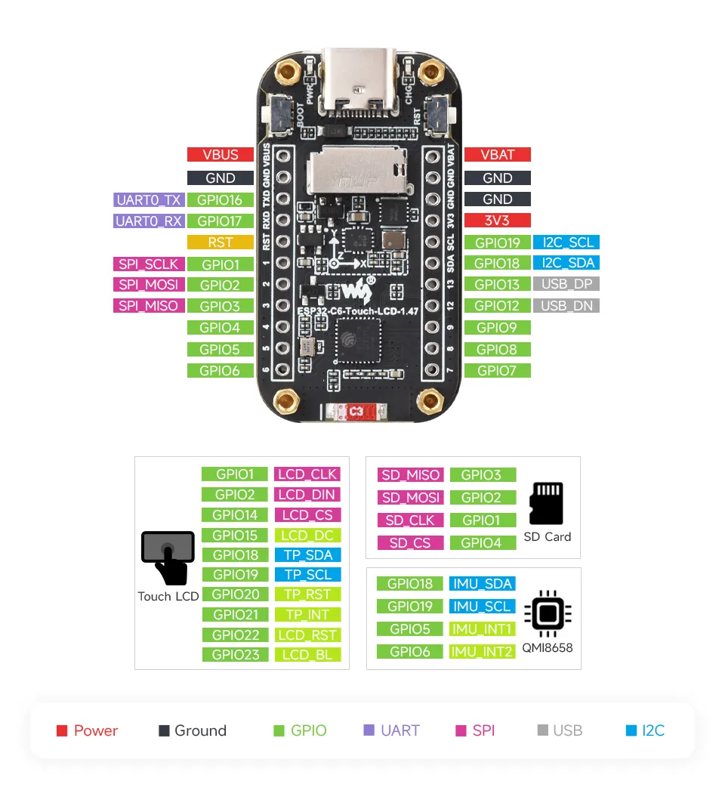

  <h1>ESP32-C6-Touch-LCD-1.47</h1>
  
<strong>ESP32-C6 1.47-inch 172 × 320 capacitive touch LCD development board examples and firmware</strong>

  
<strong>English</strong> | <a href="README_ZH.md">简体中文</a>

  
  

  
<a href="https://www.waveshare.com/esp32-c6-touch-lcd-1.47.htm">🛒 Product</a> &middot; <a href="firmware/">📦 Firmware</a> &middot; <a href="examples/esp-idf/">🧩 ESP-IDF</a> &middot; <a href="examples/arduino/examples/">🔧 Arduino</a> &middot; <a href="https://docs.waveshare.com/ESP32-C6-Touch-LCD-1.47">📖 Documentation</a>

  

---

## ✨ Overview

ESP32-C6-Touch-LCD-1.47 is an ESP32-C6FH8 development board with an integrated 1.47-inch capacitive touch LCD, TF card slot and QMI8658A IMU. This repository provides ESP-IDF and Arduino examples for the display, touch controller, storage and motion sensor.

| Feature | Device / interface |
| --- | --- |
| MCU | ESP32-C6FH8 |
| Memory | 8 MB Flash, no PSRAM |
| Display | 1.47-inch IPS, 172 × 320, 4-wire SPI, JD9853 |
| Touch | AXS5106L, I2C |

## 📦 Quick Start

The examples are built by GitHub Actions. Install the framework version below, open an example, connect the board over USB, and build and flash with its README command.

Factory firmware (restores the out-of-box demo): download the file whose name contains `FactoryOnly` from the [`firmware`](firmware/) folder.

## 🧪 Examples

### ESP-IDF

| Example | Main feature |
| --- | --- |
| [01_factory](examples/esp-idf/01_factory/) | Factory demo and touchscreen test |
| [02_sd_card_test](examples/esp-idf/02_sd_card_test/) | TF card read and write |
| [03_lvgl_example](examples/esp-idf/03_lvgl_example/) | LVGL display and touch |
| [04_lvgl_image](examples/esp-idf/04_lvgl_image/) | LVGL image display |

### Arduino

| Example | Main feature |
| --- | --- |
| [01_gfx_helloworld](examples/arduino/examples/01_gfx_helloworld/) | LCD Hello World |
| [02_qmi8658_output](examples/arduino/examples/02_qmi8658_output/) | QMI8658A motion data |
| [03_sd_card_test](examples/arduino/examples/03_sd_card_test/) | TF card file operations |
| [04_lvgl_arduino_v8](examples/arduino/examples/04_lvgl_arduino_v8/) | LVGL display and touch |
| [05_lvgl_battery](examples/arduino/examples/05_lvgl_battery/) | Battery status UI |
| [06_lvgl_brightness](examples/arduino/examples/06_lvgl_brightness/) | LCD backlight control |
| [07_lvgl_qmi8658](examples/arduino/examples/07_lvgl_qmi8658/) | LVGL and QMI8658A |
| [08_lvgl_image](examples/arduino/examples/08_lvgl_image/) | LVGL image display |

Libraries used by the sketches are bundled in [`examples/arduino/libraries`](examples/arduino/libraries/).

## 🛠️ Development Environment

| Framework | Version | Examples |
| --- | --- | ---: |
| ESP-IDF | v5.5.4 | 4 |
| Arduino-ESP32 | 3.3.10 | 8 |

## 📚 Resources

- [Product page](https://www.waveshare.com/esp32-c6-touch-lcd-1.47.htm)
- [Wiki](https://docs.waveshare.com/ESP32-C6-Touch-LCD-1.47)
- [Schematic (PDF)](hardware/schematic/ESP32-C6-Touch-LCD-1.47-Schematic-20261117.pdf)

## 🤝 Support

- Example or repository problem: [open an issue](https://github.com/waveshareteam/ESP32-C6-Touch-LCD-1.47/issues/new/choose).
- Product usage, hardware or order questions: [Waveshare support](https://service.waveshare.com/).

## 📄 License

Apache License 2.0. See [LICENSE](LICENSE).
