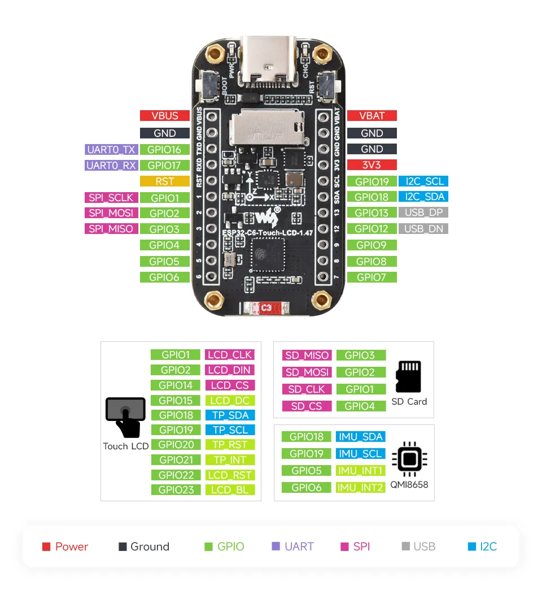

  <h1>ESP32-C6-Touch-LCD-1.47</h1>
  
<strong>ESP32-C6 1.47 英寸 172 × 320 电容触摸 LCD 开发板示例与固件</strong>

  
<a href="README.md">English</a> | <strong>简体中文</strong>

  
  

  
<a href="https://www.waveshare.com/esp32-c6-touch-lcd-1.47.htm">🛒 产品</a> &middot; <a href="firmware/">📦 固件</a> &middot; <a href="examples/esp-idf/">🧩 ESP-IDF</a> &middot; <a href="examples/arduino/examples/">🔧 Arduino</a> &middot; <a href="https://docs.waveshare.net/ESP32-C6-Touch-LCD-1.47/">📖 文档</a>

  

---

## ✨ 概述

ESP32-C6-Touch-LCD-1.47 是一块基于 ESP32-C6FH8 的开发板，集成 1.47 英寸电容触摸 LCD、TF 卡槽和 QMI8658A 惯性传感器。本仓库提供显示、触摸、存储和运动传感器的 ESP-IDF 与 Arduino 示例。

| 功能 | 器件或接口 |
| --- | --- |
| MCU | ESP32-C6FH8 |
| 存储器 | 8 MB Flash，无 PSRAM |
| 显示 | 1.47 英寸 IPS，172 × 320，4 线 SPI，JD9853 |
| 触摸 | AXS5106L，I2C |

## 📦 快速开始

示例由 GitHub Actions 构建。安装下表列出的框架版本，打开示例并按 README 中的命令编译和烧录。

出厂固件（恢复开箱演示）：在 [`firmware`](firmware/) 目录下载文件名带 `FactoryOnly` 的文件。

## 🧪 示例

### ESP-IDF

| 示例 | 主要功能 |
| --- | --- |
| [01_factory](examples/esp-idf/01_factory/) | 出厂演示与触摸测试 |
| [02_sd_card_test](examples/esp-idf/02_sd_card_test/) | TF 卡读写 |
| [03_lvgl_example](examples/esp-idf/03_lvgl_example/) | LVGL 显示与触摸 |
| [04_lvgl_image](examples/esp-idf/04_lvgl_image/) | LVGL 图片显示 |

### Arduino

| 示例 | 主要功能 |
| --- | --- |
| [01_gfx_helloworld](examples/arduino/examples/01_gfx_helloworld/) | LCD Hello World |
| [02_qmi8658_output](examples/arduino/examples/02_qmi8658_output/) | QMI8658A 运动数据 |
| [03_sd_card_test](examples/arduino/examples/03_sd_card_test/) | TF 卡文件操作 |
| [04_lvgl_arduino_v8](examples/arduino/examples/04_lvgl_arduino_v8/) | LVGL 显示与触摸 |
| [05_lvgl_battery](examples/arduino/examples/05_lvgl_battery/) | 电池状态界面 |
| [06_lvgl_brightness](examples/arduino/examples/06_lvgl_brightness/) | LCD 背光控制 |
| [07_lvgl_qmi8658](examples/arduino/examples/07_lvgl_qmi8658/) | LVGL 与 QMI8658A |
| [08_lvgl_image](examples/arduino/examples/08_lvgl_image/) | LVGL 图片显示 |

草图使用的库随仓库提供，位于 [`examples/arduino/libraries`](examples/arduino/libraries/)。

## 🛠️ 开发环境

| 开发框架 | 版本 | 示例数 |
| --- | --- | ---: |
| ESP-IDF | v5.5.4 | 4 |
| Arduino-ESP32 | 3.3.10 | 8 |

## 📚 资料

- [产品页](https://www.waveshare.com/esp32-c6-touch-lcd-1.47.htm)
- [Wiki](https://docs.waveshare.net/ESP32-C6-Touch-LCD-1.47/)
- [原理图（PDF）](hardware/schematic/ESP32-C6-Touch-LCD-1.47-Schematic-20261117.pdf)

## 🤝 支持

- 示例或仓库问题：[提交 issue](https://gitee.com/waveshare/ESP32-C6-Touch-LCD-1.47/issues)。
- 产品使用、硬件或订单问题：[微雪技术支持](https://docs.waveshare.net/ESP32-C6-Touch-LCD-1.47/Technical-Support/)。

## 📄 许可证

Apache License 2.0，详见 [LICENSE](LICENSE)。
